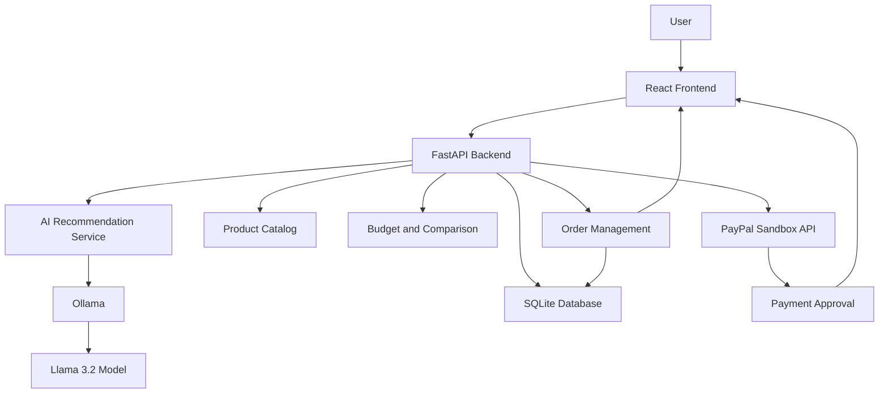

# 🛒 CartMind AI – Shop Smarter, Spend Better

**An AI-powered smart shopping assistant that helps users discover products, get intelligent recommendations, compare options, manage budgets, and complete purchases using PayPal.**

<p align="center">

  **Built with React · FastAPI · Ollama · Llama 3.2 · SQLite · PayPal**

</p>

---

## 📌 Overview

CartMind AI is an AI-powered shopping assistant designed to make online shopping smarter, easier, and more personalized.

Traditional online shopping often requires users to spend time searching for products, comparing specifications, and finding suitable options within their budget. CartMind AI simplifies this process by combining artificial intelligence with a complete shopping workflow.

Users can interact with an AI shopping assistant, discover suitable products, compare products, optimize their choices based on budget, and complete checkout using PayPal.

The application uses **Ollama with Llama 3.2** to provide locally hosted AI-powered recommendations. It also integrates PayPal Sandbox for payment testing and SQLite for storing order information and payment history.

## ✨ Features

### 🤖 AI Shopping Assistant
- Understands natural-language shopping queries.
- Generates AI-powered product recommendations.
- Uses Llama 3.2 through Ollama.
- Maintains conversation context using session-based memory.

### 🔍 Smart Product Discovery
- Explore available products.
- Search for products based on user requirements.
- View product information and prices.

### ⚖️ Product Comparison
- Compare multiple products.
- Evaluate product specifications and prices.
- Make informed purchasing decisions.

### 💰 Budget Optimization
- Find suitable products within a specified budget.
- Get recommendations based on spending limits.

### 🛒 Shopping Cart
- Add products to the cart.
- Manage product quantities.
- Calculate the total purchase amount.

### 💳 PayPal Payment Integration
- Create PayPal checkout orders.
- Redirect users to PayPal Sandbox.
- Capture payments after customer approval.
- Handle successful and cancelled checkout flows.

### 📦 Order Confirmation
- Display successful order information.
- Show purchased products and quantities.
- Display payment status and total amount.

### 📜 Payment History
- Store order information using SQLite.
- View previous orders.
- View purchased products and payment details.

---

## 🏗️ System Architecture

CartMind AI follows a frontend-backend architecture with an integrated local AI model, database, and payment service.



### Architecture Explanation

1. **Frontend – React.js:** Provides the user interface for product discovery, AI conversations, product comparison, budgeting, shopping cart, checkout, and order history.

2. **Backend – FastAPI:** Handles API requests, product operations, AI communication, budget calculations, comparison functionality, and payment processing.

3. **AI Layer – Ollama and Llama 3.2:** Runs a locally hosted language model to understand shopping queries and generate product recommendations.

4. **Database – SQLite:** Stores order information, purchased product details, payment status, and timestamps.

5. **Payment Layer – PayPal:** Handles order creation, customer approval, and payment capture through PayPal Sandbox.

---

## 🧰 Technology Stack

| Technology | Purpose |
|---|---|
| React.js | Frontend development |
| Vite | Frontend build tool |
| JavaScript | Application logic |
| HTML5 & CSS3 | UI structure and styling |
| Lucide React | Icons |
| Axios | HTTP requests |
| Python | Backend programming |
| FastAPI | REST API framework |
| Ollama | Local AI model execution |
| Llama 3.2 | AI recommendations |
| SQLite | Database |
| PayPal Sandbox | Payment integration |
| Git & GitHub | Version control |

---

## 📁 Project Structure

```text
CartMind-AI/
│
├── backend/
│   │
│   ├── app/
│   │   ├── __init__.py
│   │   ├── main.py
│   │   ├── products.py
│   │   ├── ai_service.py
│   │   └── payments.py
│   │
│   ├── .env
│   ├── .env.example
│   ├── requirements.txt
│   ├── cartmind.db
│   └── venv/
│
├── frontend/
│   ├── src/
│   │   ├── App.jsx
│   │   ├── App.css
│   │   └── ...
│   │
│   ├── public/
│   ├── package.json
│   └── ...
│
├── .gitignore
├── LICENSE
└── README.md
```

**Note:** The `cartmind.db` database is created automatically by the backend if it does not already exist. The `venv` directory is generated during backend setup and should not be uploaded to GitHub.

---

# 🚀 Installation and Setup

Follow these instructions to run CartMind AI locally on your computer.

## 1. Prerequisites

Install the following software:

- Python 3.10 or later
- Node.js and npm
- Git
- Ollama
- PayPal Sandbox developer account

Useful links:

- [Python](https://www.python.org/downloads/)
- [Node.js](https://nodejs.org/)
- [Git](https://git-scm.com/)
- [Ollama](https://ollama.com/)
- [PayPal Developer Dashboard](https://developer.paypal.com/)

## 2. Clone the Repository

Open PowerShell or your terminal.

```bash
git clone https://github.com/pearlnaveen/cartmind.git
```

Navigate into the project:

```bash
cd CartMind-AI
```


## 3. Backend Setup

Navigate to the backend directory:

```powershell
cd backend
```

Create a Python virtual environment:

```powershell
python -m venv venv
```

Activate the virtual environment:

```powershell
.\venv\Scripts\activate
```

Install the required dependencies:

```powershell
pip install -r requirements.txt
```

### Configure Environment Variables

Create a `.env` file inside the `backend` directory.

```env
PAYPAL_CLIENT_ID=your_paypal_sandbox_client_id
PAYPAL_CLIENT_SECRET=your_paypal_sandbox_client_secret
PAYPAL_BASE_URL=https://api-m.sandbox.paypal.com
```

Obtain your Sandbox credentials from the PayPal Developer Dashboard.

**Important:** Never upload your actual `.env` file or PayPal credentials to GitHub.

## 4. Ollama Setup

Download and install Ollama from:

https://ollama.com/

Download the Llama 3.2 model:

```powershell
ollama pull llama3.2
```

Verify that the model is installed:

```powershell
ollama list
```

Run the model manually to test it:

```powershell
ollama run llama3.2
```

Ollama normally runs as a background application on Windows. If it is not running, start its service:

```powershell
ollama serve
```

The default local Ollama API address is:

```text
http://localhost:11434
```

Ensure the backend's AI service is configured to use the same model name and local Ollama endpoint.

## 5. Start the Backend Server

From the `backend` directory, activate the virtual environment if necessary.

Run:

```powershell
uvicorn app.main:app --reload
```

The backend will be available at:

```text
http://localhost:8000
```

FastAPI interactive API documentation:

```text
http://localhost:8000/docs
```

## 6. Frontend Setup

Open another terminal.

Navigate to the frontend directory:

```powershell
cd frontend
```

Install frontend dependencies:

```powershell
npm install
```

Start the development server:

```powershell
npm run dev
```

The frontend will be available at:

```text
http://localhost:5173
```

Open the URL in your browser to use CartMind AI.

---

## 🔌 API Endpoints

The FastAPI backend exposes the following endpoints:

| Method | Endpoint | Description |
|---|---|---|
| GET | `/` | Backend welcome endpoint |
| GET | `/api/health` | Check backend health |
| GET | `/api/products` | Retrieve products |
| GET | `/api/products/{product_id}` | Retrieve a specific product |
| POST | `/api/recommend` | Generate AI recommendations |
| POST | `/api/compare` | Compare products |
| POST | `/api/budget` | Find products within a budget |
| POST | `/api/payments/create-order` | Create a PayPal order |
| POST | `/api/payments/capture-order/{order_id}` | Capture an approved payment |
| GET | `/api/orders` | Retrieve payment history |
| GET | `/api/orders/{order_id}` | Retrieve order details |

Refer to the interactive FastAPI documentation at `/docs` for request and response schemas.

---

## 💳 PayPal Sandbox Testing

CartMind AI uses PayPal Sandbox to demonstrate the checkout workflow without processing real payments.

To test the payment functionality:

1. Create a PayPal Developer account.
2. Create a Sandbox Business account.
3. Create a Sandbox Personal account for testing purchases.
4. Create a REST API application in the Developer Dashboard.
5. Copy its Client ID and Secret into `backend/.env`.
6. Start the backend and frontend.
7. Add products to your shopping cart.
8. Proceed to PayPal checkout.
9. Log in using your Sandbox Personal account.
10. Approve the payment and return to CartMind AI.
11. Verify the order confirmation and payment history.

**Note:** Sandbox transactions are simulated and do not transfer real money.

---

## 🧪 Running the Complete Application

You need the following services running:

| Service | Address |
|---|---|
| React Frontend | http://localhost:5173 |
| FastAPI Backend | http://localhost:8000 |
| FastAPI Documentation | http://localhost:8000/docs |
| Ollama API | http://localhost:11434 |

Make sure Ollama, the backend, and the frontend are running before testing the complete application.

---

## 🔒 Security Notes

- Do not commit `.env` files or API credentials.
- Do not upload your Python virtual environment.
- Keep PayPal credentials on the backend.
- Use PayPal Sandbox for development and testing.
- Production deployment requires proper authentication, order ownership verification, payment validation, HTTPS, and secure database configuration.

---

## 🔮 Future Enhancements

- Integration with real-time product catalogs and pricing.
- User authentication and personalized shopping profiles.
- More advanced AI-powered recommendations.
- Multi-currency support.
- Additional payment gateway integrations.
- Cloud database and application deployment.
- Improved conversational shopping experience.

---

## 🤝 Contributing

Contributions, suggestions, and improvements are welcome!

1. Fork the repository.
2. Create a feature branch.
3. Make your changes.
4. Commit your changes.
5. Submit a pull request.

---

## 📄 License

This project is intended to be released under the MIT License. See the `LICENSE` file for details.

---

## 👨‍💻 Author

**Developed as an AI-powered full-stack shopping assistant for the PayPal AI Hackathon.**

**CartMind AI – Shop Smarter, Spend Better!** 🚀